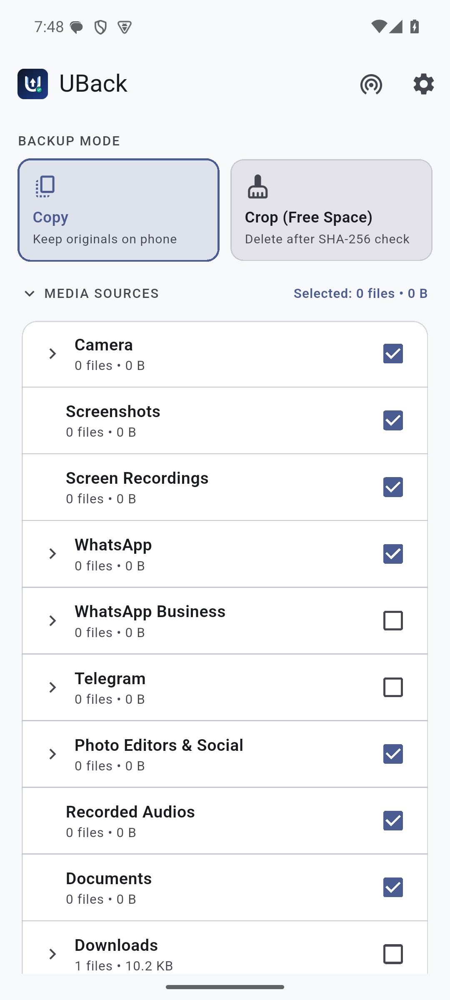
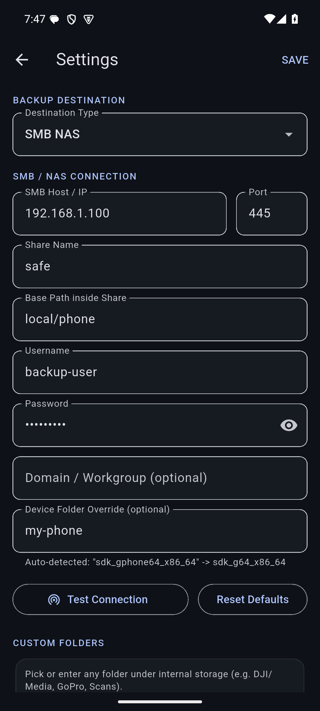

<p align="center">
  
</p>

<h1 align="center">UBack (Ultimate Backup)</h1>

<p align="center">
  Reliable Android backup app for transferring thousands of photos, videos, WhatsApp & Telegram media, documents, custom folders, and device snapshots over <strong>SMB2/SMB3</strong> with mandatory full <strong>SHA-256 read-back verification</strong>.
</p>

See [docs/RELEASE.md](docs/RELEASE.md) for the release process and [AGENTS.md](AGENTS.md) for engineering guidelines.

## Screenshots

| Home (Dark) | Home (Light) | Settings (Dark) | Settings (Light) |
| :---: | :---: | :---: | :---: |
|  |  |  |  |

## Key Features
- **Collapsible Hierarchical Media Sources**: Toggle sources and nested sub-items directly on the backup screen with live non-blocking file-count and byte-size estimates:
  - **Camera** (`Images`, `Videos`, `Expert RAW`)
  - **Screenshots** & **Screen Recordings**
  - **WhatsApp** & **WhatsApp Business** (`Received` & `Sent` -> `Images`, `Videos`, `Audios & Voice Notes`, `Documents`)
  - **Telegram** (`Images`, `Videos`, `Audios`, `Documents` — opt-in)
  - **Photo Editors & Social** (`Lightroom`, `Snapseed`, `Instagram`, `Restored & Canva`)
  - **Recorded Audios** (`Voice Recorder`, `Recordings`, `CallRecordings`)
  - **Documents** (`/Documents`) & **Downloads** (`Images & Videos`, `Documents & PDFs`, `Other Files` — opt-in)
  - **Device Snapshots** (`Contacts (.vcf)`, `SMS Messages (.json)`, `Call Logs (.json)` — opt-in, strictly read-only even in Crop Mode)
  - **Custom Folders** (browse device folders with Android's native folder picker or type any `/sdcard/...` path in Settings, e.g., `DJI/Media`, `GoPro`, `Obsidian`)
- **Full Session Persistence**: Automatically remembers your last configuration, exporter, backup mode (`Copy`/`Crop`), batch limit (`All`/`Oldest X files`/`Oldest X MB`), exact source toggles, custom folders, and expand/collapse state across restarts.
- **Extensible Destinations**: Built on an abstract `BackupDestination` interface (`SMB NAS` active now, configurable for additional destinations in `config.toml` and Settings).
- **Destination Layout**: `smb://{host}:{port}/{share}/{base_path}/{device_name}/{source}/{YYYY}/{MM}/{filename}` (e.g., `.../camera/2025/04/`, `.../whatsapp/sent/videos/2025/04/`, `.../custom/dji-media/2025/04/`).
- **Modes**:
  - **Copy**: Transfers and verifies files on the destination, leaving local files untouched.
  - **Crop (Free Space)**: Verifies every file via full SHA-256 read-back before deleting the local file and refreshing Android MediaStore (Device Snapshots never delete real Contacts, SMS, or Call Logs).
- **Global Oldest-First & Batch Limits**: Always orders oldest-first across **all** enabled sources combined; optionally limit a run to `All`, `Oldest X files`, or `Oldest X MB`.
- **High-Volume UX**: Zero media thumbnails or previews — lightweight progress counters (`Transferred`, `Remaining`, `Total`, `Skipped`, `Failed`) with a pinned Android Foreground Service progress notification.
- **Adaptive System Theme & Foldable / Landscape Support**: Material 3 Light and Dark themes follow your system theme, with an automatic two-pane hinge-aware layout for landscape phones, tablets, and foldable dual-screen devices (`DisplayFeature` hinge/fold avoidance).
- **Compile-Time Defaults + In-App Settings**: Local gitignored `config.toml` injects default destination settings at build time, while Settings lets you edit or override them at runtime (credentials stored with Android secure storage).

## Install on Android (Direct Download)

> **[Download Latest APK (`uback-latest.apk`)](https://github.com/rodvieirasilva/uback/releases/latest/download/uback-latest.apk)** · [All Releases & Checksums](https://github.com/rodvieirasilva/uback/releases/latest)

1. Tap **[Download Latest APK](https://github.com/rodvieirasilva/uback/releases/latest/download/uback-latest.apk)** directly on your Android phone.
2. Open the downloaded `.apk` file and tap **Install** (allow installing unknown apps from your browser/file manager if prompted).
3. Launch **UBack**, tap **Settings** (gear icon), enter your **SMB NAS** details (`Host`, `Share`, `Base Path`, `Username`, `Password`), tap **Test Connection** -> **Save**, and grant media + **All files access** permissions (needed for Crop Mode and WhatsApp Sent / Voice Notes).

<details>
<summary>Optional: Verify SHA-256 checksum or install via ADB</summary>

```bash
# Download the versioned APK + checksum from Releases, then verify:
sha256sum -c uback-vX.Y.Z.apk.sha256

# Install over USB or Wireless ADB:
adb install -r uback-latest.apk
```
</details>

## Quick Start (Build from Source)

### 1. Install Toolchain with `mise`
```bash
mise trust
mise install
```

### 2. Configure Local NAS Defaults (Never Committed)
```bash
cp config.example.toml config.toml
# Edit config.toml with your NAS host, share, base_path, username, and password
```

### 3. Common Tasks
```bash
mise run analyze         # Flutter static analysis
mise run test            # Dart unit & widget tests
mise run coverage        # Run unit/widget tests and enforce >= 80% Dart line coverage
mise run test-e2e        # Full Android Emulator E2E tests against a real local SMB2 server
mise run screenshots     # Refresh Dark & Light screenshots in docs/screenshots/
mise run release-check   # Run analyze + unit/widget + Emulator E2E tests
mise run build-apk       # Build debug APK with config.toml defaults injected
mise run build-release   # Build release APK with config.toml defaults injected
mise run deploy-device   # Build & install debug APK onto connected wireless ADB phone
mise run deploy-release  # Build & install release APK onto connected wireless ADB phone
```

## Project Layout
- `docs/RELEASE.md` — Version bump, screenshot refresh, and release checklist
- `docs/logo.png` & `docs/screenshots/` — App icon and Dark/Light UI screenshots
- `mise.toml` — Tooling versions (`java`, `flutter`, Android SDK env) and automation tasks
- `config.example.toml` — Template for gitignored `config.toml`
- `scripts/` — Build, config-injection, icon generation, screenshot capture, ADB deployment, and Emulator E2E scripts
- `mobile/` — Flutter Android application + native Kotlin `smbj` engine & Foreground Service
