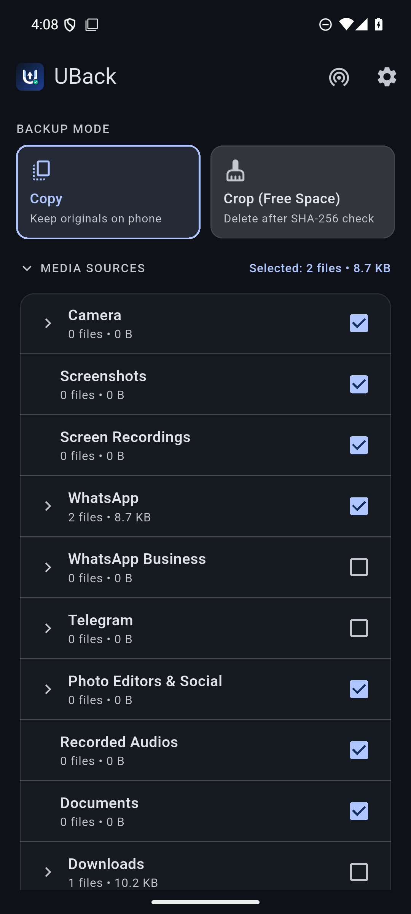
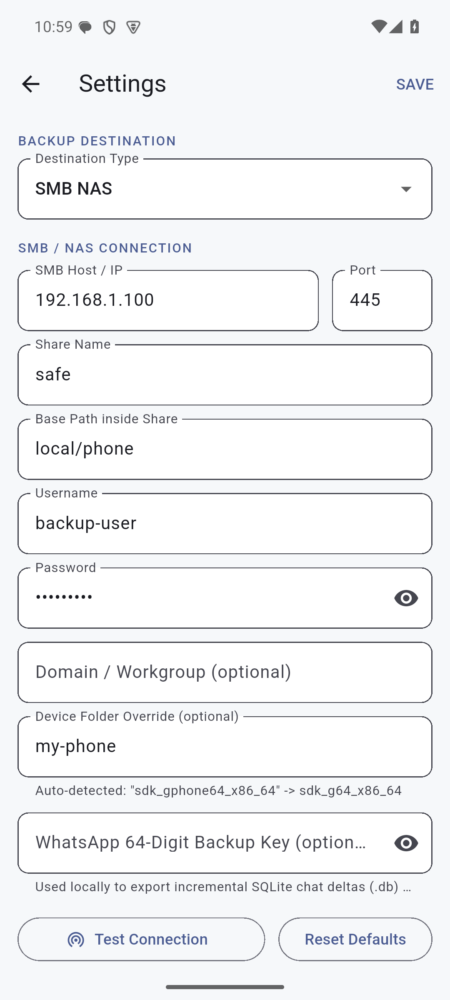

<p align="center">
  
</p>

<h1 align="center">UBack (Ultimate Backup)</h1>

<p align="center">
  Reliable Android backup app for transferring thousands of photos, videos, WhatsApp & Telegram media, documents, custom folders, and device snapshots over <strong>SMB2/SMB3</strong> with mandatory full <strong>SHA-256 read-back verification</strong>.
</p>

See [docs/RELEASE.md](docs/RELEASE.md) for the release process and [AGENTS.md](AGENTS.md) for engineering guidelines.

## Screenshots

| Home (Dark) | Home (Light) | Settings (Dark) | Settings (Light) |
| :---: | :---: | :---: | :---: |
|  |  |  |  |

## Key Features
- **Collapsible Hierarchical Media Sources**: Toggle sources and nested sub-items directly on the backup screen with live non-blocking file-count and byte-size estimates:
  - **Camera** (`Images`, `Videos`, `Expert RAW`)
  - **Screenshots** & **Screen Recordings**
  - **WhatsApp** & **WhatsApp Business** (`Received` & `Sent` -> `Images`, `Videos`, `Audios & Voice Notes`, `Documents`, plus **Chat Databases (Read-Only)** for `Databases/` & `Backups/` and **Incremental Chat Deltas (`.db`)** for zero-duplication incremental message archiving)
  - **Telegram** (`Images`, `Videos`, `Audios`, `Documents` — opt-in)
  - **Photo Editors & Social** (`Lightroom`, `Snapseed`, `Instagram`, `Restored & Canva`)
  - **Recorded Audios** (`Voice Recorder`, `Recordings`, `CallRecordings`)
  - **Documents** (`/Documents`) & **Downloads** (`Images & Videos`, `Documents & PDFs`, `Other Files` — opt-in)
  - **Device Snapshots** (`Contacts (.vcf)`, `SMS Messages (.json)`, `Call Logs (.json)` — opt-in, strictly read-only even in Crop Mode)
  - **Custom Folders** (browse device folders with Android's native folder picker or type any `/sdcard/...` path in Settings, e.g., `DJI/Media`, `GoPro`, `Obsidian`)
- **Full Session Persistence**: Automatically remembers your last configuration, exporter, backup mode (`Copy`/`Crop`), batch limit (`All`/`Oldest X files`/`Oldest X MB`), exact source toggles, custom folders, and expand/collapse state across restarts.
- **High-Speed SMB2/SMB3 Pipelined Engine**: Dynamically selects optimal I/O and SMB2 `LargeMTU` buffer sizes (`64 KB` for small files, `256 KB` for photos/docs, `1 MB` for medium videos, and `4 MB` for huge WhatsApp `.crypt15` databases and 4K videos), pipelines multi-credit SMB2 `WRITE` requests concurrently, and computes local SHA-256 **in a single pass while uploading** for new files (eliminating the separate pre-upload hashing pass).
- **Destination Layout**: `smb://{host}:{port}/{share}/{base_path}/{device_name}/{source}/{YYYY}/{MM}/{filename}` (e.g., `.../camera/2025/04/`, `.../whatsapp/sent/videos/2025/04/`, `.../custom/dji-media/2025/04/`).
- **Modes**:
  - **Copy**: Transfers and verifies files on the destination, leaving local files untouched.
  - **Crop (Free Space)**: Verifies every file via full SHA-256 read-back before deleting the local file and refreshing Android MediaStore (Device Snapshots and WhatsApp Chat Databases are strictly read-only and never deleted).
- **Global Oldest-First & Batch Limits**: Always orders oldest-first across **all** enabled sources combined; optionally limit a run to `All`, `Oldest X files`, or `Oldest X MB`.
- **High-Volume UX with Pause / Resume, Continue From Last Stop, Live ETA, Large-File Progress & Content-Hash Deduplication**: Zero media thumbnails or previews — lightweight progress counters (`Transferred`, `Remaining`, `Total`, `Skipped`, `Failed`, `Elapsed`, `ETA`), an automatic **per-file progress bar** (`Hashing file` / `Uploading file` / `Verifying SHA-256` with percentage, bytes, and file timer) whenever a large file takes longer than 5 seconds, live **Pause / Resume** controls in both the app and Android Foreground Notification, a persistent **Continue From Last Stop (`N` files left)** option (plus byte-offset `.uback.tmp` resume for interrupted large files), and automatic **SHA-256 deduplication** that skips copying any file whose hash already matches in the destination folder (even under a different filename).
- **Adaptive System Theme & Foldable / Landscape Support**: Material 3 Light and Dark themes follow your system theme, with an automatic two-pane hinge-aware layout for landscape phones, tablets, and foldable dual-screen devices (`DisplayFeature` hinge/fold avoidance).
- **Compile-Time Defaults + In-App Settings**: Local gitignored `config.toml` injects default destination settings at build time, while Settings lets you edit or override them at runtime (credentials stored with Android secure storage).

## Install on Android (Direct Download)

> **[Download Latest APK (`uback-latest.apk`)](https://github.com/rodvieirasilva/uback/releases/latest/download/uback-latest.apk)** · [All Releases & Checksums](https://github.com/rodvieirasilva/uback/releases/latest)

1. Tap **[Download Latest APK](https://github.com/rodvieirasilva/uback/releases/latest/download/uback-latest.apk)** directly on your Android phone.
2. Open the downloaded `.apk` file and tap **Install** (allow installing unknown apps from your browser/file manager if prompted).
3. Launch **UBack**, tap **Settings** (gear icon), enter your **SMB NAS** details (`Host`, `Share`, `Base Path`, `Username`, `Password`), tap **Test Connection** -> **Save**, and grant media + **All files access** permissions (needed for Crop Mode and WhatsApp Sent / Voice Notes).

### If Google Play Protect Blocks Installation ("Requires sensitive permissions")

Because UBack is sideloaded outside the Play Store and declares local backup permissions (`All files access`, plus opt-in `Contacts`, `SMS`, and `Call Logs` snapshots), **Google Play Protect** may warn or block installation on Android 13–16. Every release APK is built transparently in GitHub Actions from this repository with zero cloud telemetry.

To install when Play Protect blocks it:
- **Option 1 — "Install anyway" (when shown):** On the Play Protect dialog, tap **More details** -> **Install anyway**.
- **Option 2 — Temporarily pause Play Protect (when "Install anyway" is hidden):**
  1. Open **Google Play Store** -> tap your **Profile icon** (top-right) -> **Play Protect** -> **Settings** (gear icon).
  2. Toggle off **Scan apps with Play Protect** temporarily.
  3. Install `uback-latest.apk`.
  4. Turn **Scan apps with Play Protect** back **ON** immediately after installation.
- **Option 3 — Install via ADB (recommended if you have a PC, no Play Protect toggle needed):**
  ```bash
  adb install -r uback-latest.apk
  ```
- **Enabling SMS & Call Logs on sideloaded APKs (Android 13+ Restricted Settings):** If Android grays out **SMS** or **Call Logs** permissions, open **Settings → Apps → UBack → ⋮ (top-right) → Allow restricted settings**, then toggle **Device Snapshots** back on in UBack. *(ADB installs are exempt from this restriction automatically.)*

<details>
<summary>Optional: Verify SHA-256 checksum before installing</summary>

```bash
# Download the versioned APK + checksum from Releases, then verify:
sha256sum -c uback-vX.Y.Z.apk.sha256
```
</details>

## WhatsApp Message Databases & Incremental SQLite Deltas

Under **Media Sources → WhatsApp** (and **WhatsApp Business**), UBack supports two complementary, root-free message backup layers:

### 1. Chat Databases (Read-Only) — `.crypt14` / `.crypt15`
- **Source folders**: `Android/media/com.whatsapp/WhatsApp/Databases/` (`msgstore.db.crypt14` / `.crypt15` + daily dated backups) and `Backups/` (`wa.db.crypt*`, chat settings, etc.), plus legacy `/WhatsApp/` paths.
- **Destination layout**: `{device}/whatsapp/databases/{YYYY}/{MM}/` and `{device}/whatsapp/backups/{YYYY}/{MM}/`.
- **Strictly read-only**: Even in **Crop Mode**, UBack **never** deletes local WhatsApp database or backup files on your phone, and skips unchanged files automatically via SHA-256 deduplication.
- **Restoring to a phone (same number)**: Copy `Databases/` and `Backups/` back into `Android/media/com.whatsapp/WhatsApp/` before verifying your number during WhatsApp setup — WhatsApp restores directly from the local `.crypt14` / `.crypt15` backup.

### 2. Incremental Chat Deltas (`.db`) — Zero Duplication, Preserves Deleted Messages
- **How it works (no root required)**:
  1. In WhatsApp, enable **Settings → Chats → Chat backup → End-to-end encrypted backup → Use 64-digit encryption key** and save your 64-character hex key.
  2. Enter that 64-digit key in UBack **Settings → WhatsApp 64-Digit Backup Key** (stored in Android secure storage) or inject it at build time via `config.toml` (`[whatsapp].backup_key_64`) or `WHATSAPP_64DIGI_<device>` env vars.
  3. On each backup run, UBack decrypts `msgstore.db.crypt15` locally in app cache (AES-256-GCM + zlib), queries **only** rows with `_id > lastExportedRowId`, and writes a self-contained **SQLite delta file** (`msgstore_delta_<YYYYMMDD>_<fromId>_<toId>.db`) containing `delta_meta`, the new `message` rows, and referenced `chat`, `jid`, and `message_media` rows.
  4. The full decrypted DB is wiped from app cache immediately after extraction; the small delta `.db` is uploaded to `{device}/whatsapp/deltas/{YYYY}/{MM}/` (or `whatsapp-business/deltas/`) with full **SHA-256 read-back verification**.
  5. The persistent watermark (`lastExportedRowId`) is committed **strictly after** SMB SHA-256 verification succeeds — if a backup is interrupted, the next run cleanly retries; if 0 new messages arrived, 0 files are created. Messages deleted from your phone later remain permanently preserved in earlier delta `.db` files on your NAS.
- **Merging delta files on PC / NAS**:
  ```bash
  python3 scripts/merge_whatsapp_deltas.py /path/to/nas/whatsapp/deltas ./whatsapp_archive.db
  ```
- **Building per-device local APKs with pre-filled keys (never committed)**:
  ```bash
  # Export one variable per device (or place them in ~/.credentials):
  export WHATSAPP_64DIGI_myphone="<64-hex-chars>"
  python3 scripts/build_device_apks.py --push-downloads
  # Saves dist-local/uback-vX.Y.Z-myphone.apk (gitignored) and copies to /sdcard/Download/
  ```

## Quick Start (Build from Source)

### 1. Install Toolchain with `mise`
```bash
mise trust
mise install
```

### 2. Configure Local NAS Defaults (Never Committed)
```bash
cp config.example.toml config.toml
# Edit config.toml with your NAS host, share, base_path, username, and password
```

### 3. Common Tasks
```bash
mise run analyze         # Flutter static analysis
mise run test            # Dart unit & widget tests
mise run coverage        # Run unit/widget tests and enforce >= 80% Dart line coverage
mise run test-e2e        # Full Android Emulator E2E tests against a real local SMB2 server
mise run screenshots     # Refresh Dark & Light screenshots in docs/screenshots/
mise run release-check   # Run analyze + unit/widget + Emulator E2E tests
mise run build-apk       # Build debug APK with config.toml defaults injected
mise run build-release   # Build release APK with config.toml defaults injected
mise run deploy-device   # Build & install debug APK onto connected wireless ADB phone
mise run deploy-release  # Build & install release APK onto connected wireless ADB phone
```

## Project Layout
- `docs/RELEASE.md` — Version bump, screenshot refresh, and release checklist
- `docs/logo.png` & `docs/screenshots/` — App icon and Dark/Light UI screenshots
- `mise.toml` — Tooling versions (`java`, `flutter`, Android SDK env) and automation tasks
- `config.example.toml` — Template for gitignored `config.toml`
- `scripts/` — Build, config-injection, icon generation, screenshot capture, ADB deployment, and Emulator E2E scripts
- `mobile/` — Flutter Android application + native Kotlin `smbj` engine & Foreground Service
